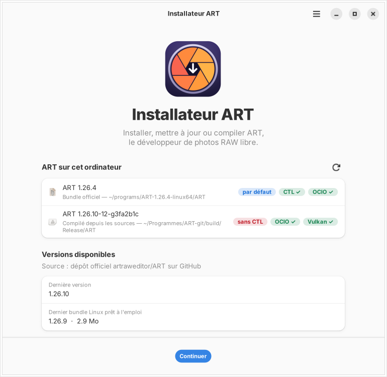
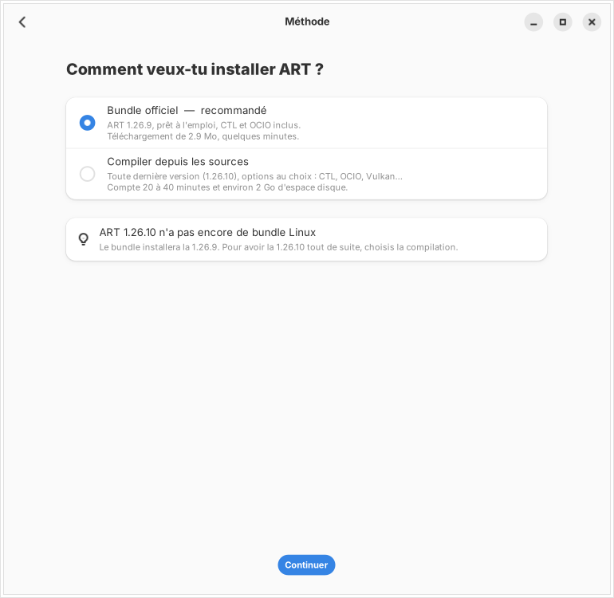
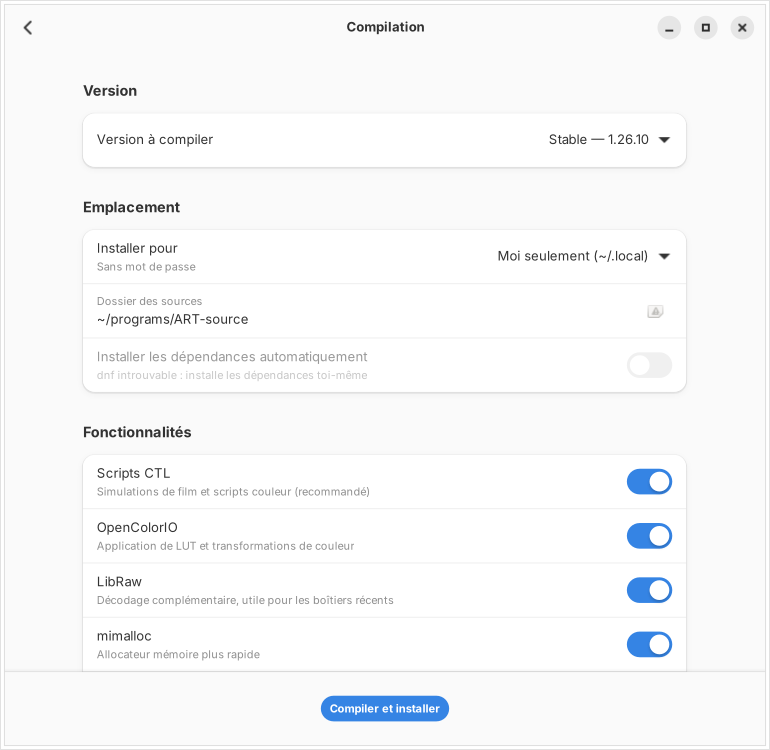
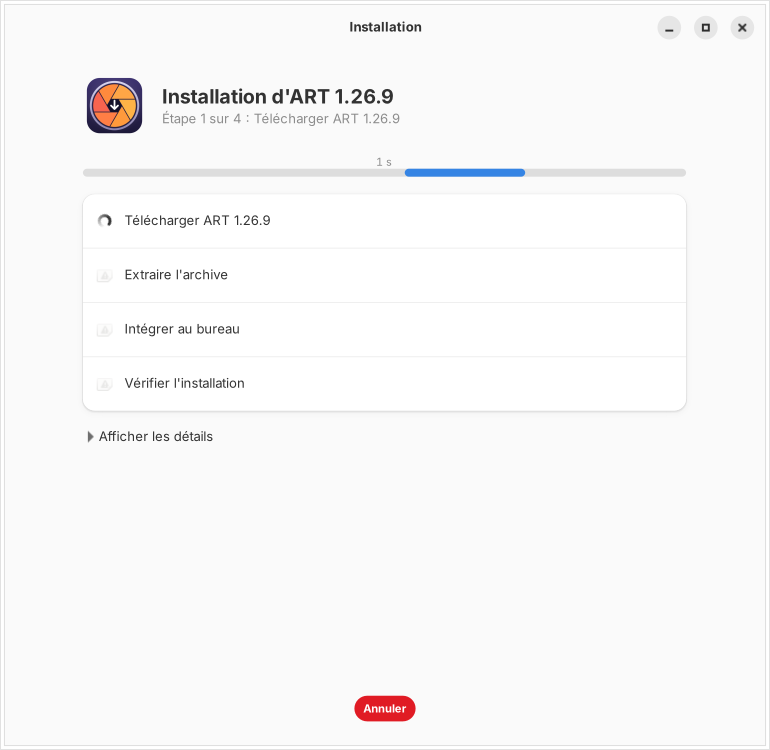
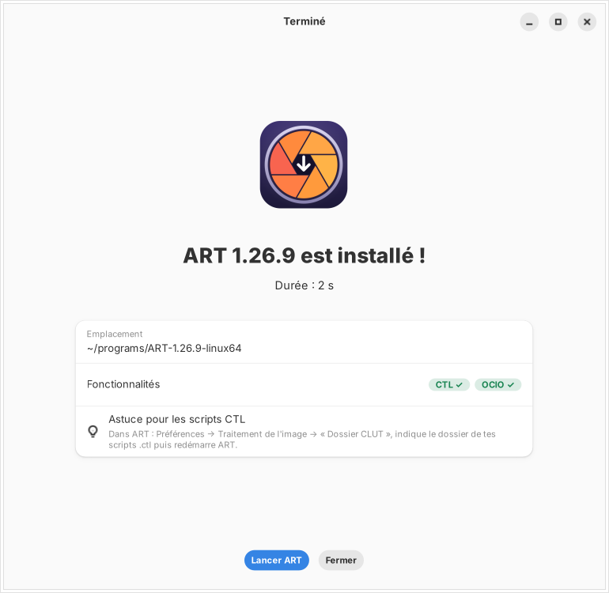

<div align="center">


# Installateur ART

**Installer, mettre à jour ou compiler [ART](https://github.com/artraweditor/ART), le développeur de photos RAW libre, en quelques clics.**

[](LICENSE)




</div>

---

## Pourquoi cet installateur ?

ART n'est pas toujours simple à installer sous Linux : le bundle officiel ne sort pas toujours en même temps que la dernière version, et pour compiler avec le support des scripts CTL, il faut connaître les bonnes dépendances et les bonnes options.

L'Installateur ART s'en charge pour vous, avec une interface claire, et vérifie à la fin que tout fonctionne.

## Fonctionnalités

| | |
|---|---|
| 🔍 **Détection** | Trouve toutes les versions d'ART déjà installées (bundle, compilée, paquet, Flatpak, AppImage) et indique pour chacune si le CTL, l'OCIO et Vulkan sont actifs. |
| 🌐 **Versions à jour** | Interroge le dépôt officiel d'ART et signale quand la dernière version n'a pas encore de bundle Linux. |
| 📦 **Bundle officiel** | Télécharge et installe le bundle prêt à l'emploi (CTL et OCIO inclus), crée les commandes `ART` / `ART-cli` et l'icône dans le menu. |
| 🛠️ **Compilation** | Compile ART depuis les sources, version stable ou de développement, avec les options de votre choix. |
| ⚙️ **Options** | Scripts CTL, OpenColorIO, LibRaw, mimalloc, accélération GPU Vulkan (expérimental), optimisation pour votre processeur, LTO. |
| 📥 **Dépendances** | Installe automatiquement les paquets nécessaires avec `dnf` (Fedora). |
| ✅ **Vérification** | Lit le fichier `AboutThisBuild.txt` d'ART pour confirmer que les fonctionnalités demandées sont bien présentes. |
| 🧹 **Nettoyage** | Propose de supprimer les anciens bundles, toujours après confirmation. Une version compilée n'est jamais touchée. |
| 📝 **Journal** | Détails de chaque étape à l'écran, et journal complet copiable pour demander de l'aide sur le forum. |

## Captures d'écran

| Choix de la méthode | Options de compilation |
|:---:|:---:|
|  |  |
| **Installation en cours** | **Terminé** |
|  |  |

## Installation

### Prérequis

Python 3, GTK 4 et libadwaita. Ils sont déjà présents sur Fedora Workstation. Sinon :

```bash
sudo dnf install git python3-gobject gtk4 libadwaita
```

### 1. Télécharger l'installateur

```bash
git clone https://github.com/carafife/art-installer.git ~/art-installer
```

### 2. L'ajouter au menu des applications

```bash
~/art-installer/install.sh
```

### 3. Le lancer

Ouvrez **Installateur ART** depuis le menu des applications, ou tapez :

```bash
art-installer
```

<details>
<summary><b>Autres opérations</b> (mise à jour, essai, désinstallation, sans git)</summary>

**Mettre à jour l'installateur**

```bash
git -C ~/art-installer pull && ~/art-installer/install.sh
```

**L'essayer sans l'installer**

```bash
~/art-installer/art-installer.py
```

**Le désinstaller** (ART lui-même n'est pas touché)

```bash
~/art-installer/install.sh --remove
```

**Sans git** : bouton **Code → Download ZIP** en haut de cette page, décompressez l'archive, puis lancez `install.sh` depuis le dossier obtenu.

</details>

## Utilisation

1. **Accueil** : l'installateur affiche les versions d'ART présentes sur votre ordinateur et celles disponibles en ligne.
2. **Méthode** : choisissez le **bundle officiel** (recommandé, quelques minutes) ou la **compilation** (dernière version et options au choix, 20 à 40 minutes).
3. **Options** : réglez l'emplacement et les fonctionnalités. Le bouton « Voir les commandes » montre tout ce qui sera exécuté.
4. **Installation** : suivez la progression, avec le journal détaillé si besoin.
5. **Terminé** : vérifiez les fonctionnalités actives, puis lancez ART.

📖 **Le guide complet est dans [AIDE.md](AIDE.md)** : chaque écran, chaque option, à quoi elle sert et quand l'activer, ainsi que les problèmes fréquents. Il s'ouvre aussi depuis le menu ☰ → **Aide** de l'application.

## Bundle ou compilation ?

| | Bundle officiel | Compilation |
|---|:---:|:---:|
| Durée | Quelques minutes | 20 à 40 minutes |
| Espace disque | ~300 Mo | ~2 Go |
| Mot de passe administrateur | Non | Pour les dépendances |
| CTL et OpenColorIO | ✅ Inclus | ✅ Au choix |
| Toute dernière version | Pas toujours | ✅ |
| Accélération Vulkan | ❌ | ✅ Expérimental |
| Optimisé pour votre processeur | ❌ | ✅ |

**En résumé :** prenez le bundle pour simplement utiliser ART, compilez pour avoir la toute dernière version ou une option particulière.

## Après l'installation : les scripts CTL

Pour utiliser des simulations de film et autres scripts `.ctl` :

1. Dans ART, ouvrez **Préférences → Traitement de l'image**.
2. Dans **Dossier CLUT**, indiquez le dossier de vos scripts.
3. **Redémarrez ART.**

## Compatibilité

- **Testé sur :** Fedora (GNOME).
- **Autres distributions :** l'installation du bundle fonctionne partout où GTK 4 et libadwaita sont disponibles. Pour la compilation, désactivez l'installation automatique des dépendances et installez les paquets équivalents vous-même.
- **Architectures :** x86_64 et aarch64.

## Signaler un problème

Ouvrez une [issue](https://github.com/carafife/art-installer/issues) en joignant le journal de l'installation. Il se copie avec le bouton **Copier le journal** de l'écran de fin, ou se trouve dans :

```
~/.cache/art-installer/derniere-installation.log
```

## À propos

L'Installateur ART est un **projet communautaire indépendant**, issu de la communauté francophone d'ART. Il n'est pas développé par l'équipe d'ART.

ART est développé par Alberto Griggio et ses contributeurs : [github.com/artraweditor/ART](https://github.com/artraweditor/ART).

## Licence

[GPL-3.0-or-later](LICENSE) © Philippe (carafife)
